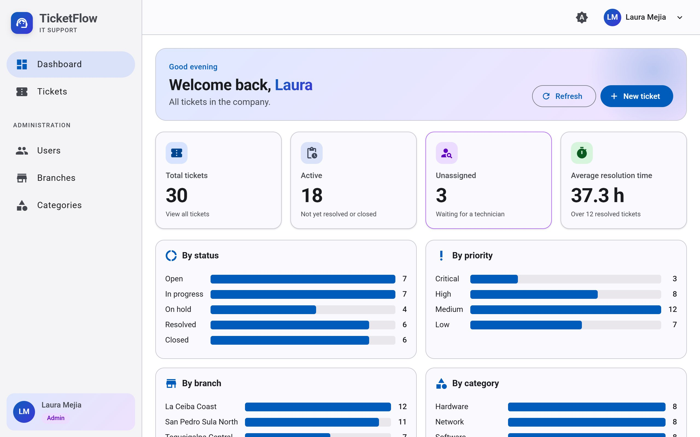
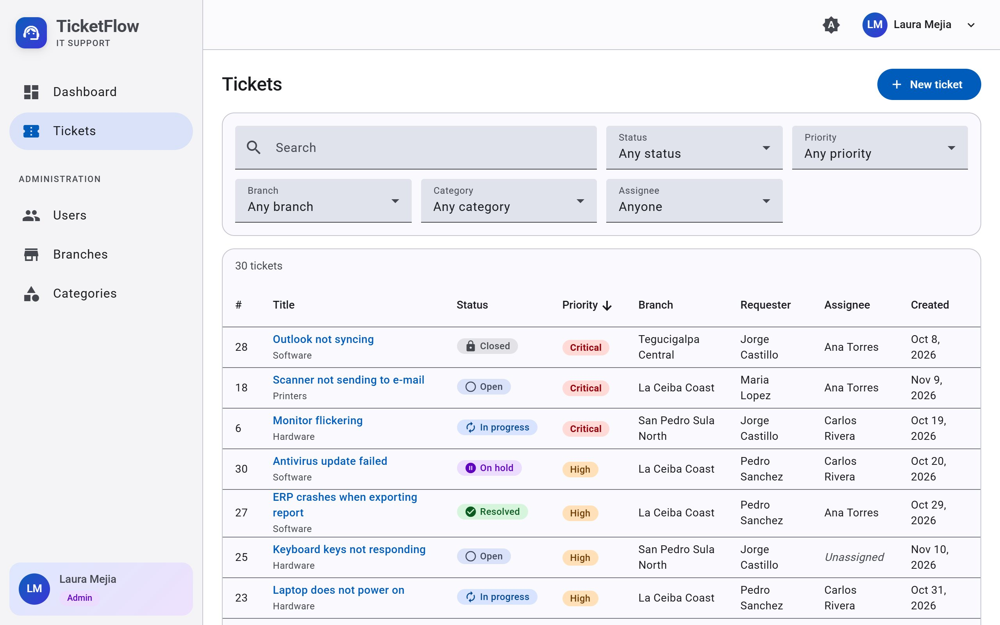
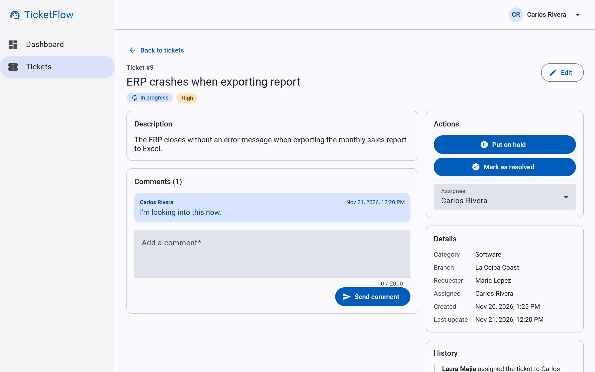
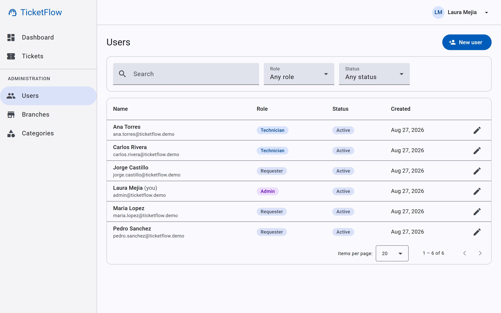
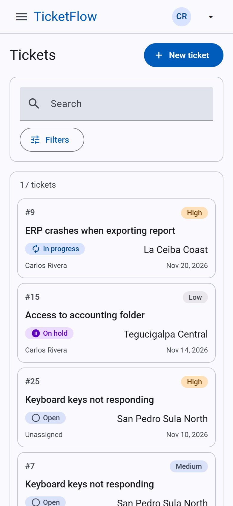
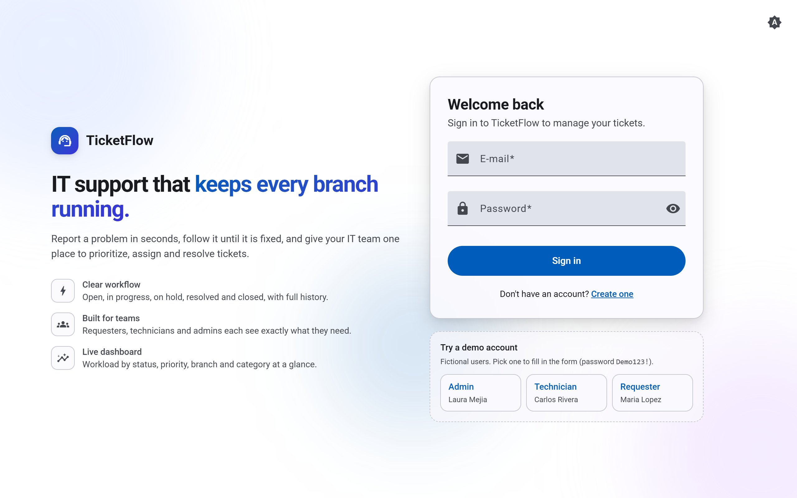

# TicketFlow

[](https://github.com/Darlangas17/ticketflow/actions/workflows/ci.yml)

IT support ticket system for a company with multiple branches: employees report problems, technicians
work on them through a defined workflow, and admins manage users, branches and categories.
*Sistema de tickets de soporte TI para una empresa con varias sucursales.*

[English](#english) · [Español](#español)

| Dashboard | Ticket list |
|---|---|
|  |  |
| **Ticket detail** | **User administration** |
|  |  |

<p align="center">
  
  
</p>

## Stack

- **Backend:** .NET 8, ASP.NET Core Web API, Entity Framework Core 8, FluentValidation
- **Database:** SQL Server 2022 (Docker)
- **Auth:** JWT (HMAC-SHA256) + BCrypt
- **Frontend:** Angular 21 (standalone components, signals, lazy-loaded routes) + Angular Material
- **Tests:** xUnit + FluentAssertions + WebApplicationFactory (backend), Vitest (frontend)
- **DevOps:** Docker Compose, nginx, GitHub Actions

## Quick start / Inicio rápido

```bash
docker compose up --build
```

Then open **http://localhost:4200** and sign in with a demo account (the login page has buttons for each).
API and Swagger: **http://localhost:5000/swagger**. The first start takes a few minutes (images and SQL Server).
*Abre http://localhost:4200 e inicia sesión con un usuario demo.*

| Role | E-mail | Password |
|---|---|---|
| Admin | `admin@ticketflow.demo` | `Demo123!` |
| Technician | `carlos.rivera@ticketflow.demo` | `Demo123!` |
| Requester | `maria.lopez@ticketflow.demo` | `Demo123!` |

All data is fictional. The compose file uses local demo settings; for anything else copy `.env.example` to
`.env` and set your own SQL Server password and JWT key.

## Structure / Estructura

```
backend/
  src/TicketFlow.Domain          Entities and enums
  src/TicketFlow.Application     DTOs, services, interfaces
  src/TicketFlow.Infrastructure  EF Core DbContext, migrations, demo seed
  src/TicketFlow.Api             ASP.NET Core host
  tests/TicketFlow.Tests         xUnit tests
frontend/
  ticketflow-web                 Angular app
```

---

## English

The quick start above runs everything in Docker. The sections below run the API and the frontend directly,
for development.

### Prerequisites

- [.NET SDK](https://dotnet.microsoft.com/download) 8 or newer (projects target `net8.0`)
- [Docker](https://www.docker.com/) (for SQL Server)
- [Node.js](https://nodejs.org/) 20.19+, 22.12+ or 24+ and **npm 11** (for the frontend; see [Frontend](#frontend))

### 1. Start SQL Server

```bash
docker run -d --name ticketflow-sql \
  -e ACCEPT_EULA=Y -e "MSSQL_SA_PASSWORD=<YourStrong!Passw0rd>" \
  -p 1433:1433 -v ticketflow-sql-data:/var/opt/mssql \
  mcr.microsoft.com/mssql/server:2022-latest
```

### 2. Configure the secrets

The connection string and the JWT signing key are secrets and are **not** stored in the repo. For local
development use [user secrets](https://learn.microsoft.com/aspnet/core/security/app-secrets) (stored outside the project folder):

```bash
cd backend
dotnet user-secrets set "ConnectionStrings:Default" \
  "Server=localhost,1433;Database=TicketFlow;User Id=sa;Password=<YourStrong!Passw0rd>;TrustServerCertificate=True" \
  --project src/TicketFlow.Api

# Any random string of at least 32 characters, e.g. generated with: openssl rand -base64 48
dotnet user-secrets set "Jwt:SigningKey" "<random-string-of-32+-characters>" --project src/TicketFlow.Api
```

Alternatively, use the environment variables `ConnectionStrings__Default` and `Jwt__SigningKey`.
The API refuses to start if the signing key is missing or shorter than 32 characters.

### 3. Apply migrations and seed demo data

**Option A: run the API.** In the `Development` environment it applies pending migrations and inserts
the demo data automatically (only if the database is empty):

```bash
dotnet run --project src/TicketFlow.Api
```

**Option B: EF Core CLI.** `dotnet-ef` is pinned as a local tool in `dotnet-tools.json`:

```bash
dotnet tool restore
dotnet ef database update --project src/TicketFlow.Infrastructure --startup-project src/TicketFlow.Api
```

This creates the schema only; the demo data is inserted the next time the API starts.

### Working with migrations

```bash
# Create a new migration after changing entities or configurations
dotnet ef migrations add <Name> --project src/TicketFlow.Infrastructure \
  --startup-project src/TicketFlow.Api --output-dir Persistence/Migrations

# Remove the last migration (only if it has not been applied)
dotnet ef migrations remove --project src/TicketFlow.Infrastructure --startup-project src/TicketFlow.Api

# Start over with an empty database (deletes all data)
dotnet ef database drop --project src/TicketFlow.Infrastructure --startup-project src/TicketFlow.Api
```

### Authentication and Swagger

With the API running in Development, open **http://localhost:5000/swagger**.

1. Call `POST /api/auth/login` with a demo user (see below) and copy the `accessToken`.
2. Click **Authorize** and paste the token (without the `Bearer ` prefix).
3. Endpoints with a padlock now send the token, e.g. `GET /api/auth/me`.

| Method | Route | Auth | Description |
|---|---|---|---|
| POST | `/api/auth/register` | Public | Creates an account (always with the Requester role) and returns a token |
| POST | `/api/auth/login` | Public | Returns a JWT (valid 60 min) and the user's data |
| GET | `/api/auth/me` | Bearer token | Current user |

Every endpoint requires a valid token unless it is marked as public. Errors use
[ProblemDetails](https://www.rfc-editor.org/rfc/rfc7807): 400 validation, 401 invalid credentials or token,
403 disabled account, 409 e-mail already registered, 429 too many sign-in attempts (10 per minute per client,
configurable with `RateLimiting:AuthPermitLimit`).

### Tickets

| Method | Route | Who | Description |
|---|---|---|---|
| GET | `/api/tickets` | Any role | Paginated list with filters, search and sort (see below) |
| GET | `/api/tickets/{id}` | Any role | Details with comments, history and the allowed next statuses |
| POST | `/api/tickets` | Any role | Creates an `Open` ticket with the caller as requester |
| PUT | `/api/tickets/{id}` | Any role | Edits title, description, priority and category (not when `Closed`) |
| PATCH | `/api/tickets/{id}/status` | Staff; requester only to close | Changes the status and records it in the history |
| PATCH | `/api/tickets/{id}/assign` | Technician, Admin | Assigns an active technician/admin (`null` unassigns) |
| POST | `/api/tickets/{id}/comments` | Any role | Adds a comment (not when `Closed`) |
| DELETE | `/api/tickets/{id}` | Admin | Deletes the ticket with its comments and history |

**List parameters:** `page` (default 1), `pageSize` (default 20, max 100), `status`, `priority`, `branchId`,
`categoryId`, `assigneeId`, `search` (title, description or ticket number such as `#12`) and `sort`
(`createdAt`, `updatedAt`, `priority`, `status`, `title`; prefix with `-` for descending, default `-createdAt`).
Example: `GET /api/tickets?status=InProgress&priority=High&sort=-priority&page=1&pageSize=20`.

**Visibility by role**

- **Requester:** only their own tickets.
- **Technician:** tickets assigned to them plus unassigned tickets.
- **Admin:** every ticket.

A ticket outside the caller's visibility returns **404** (not 403), so the API does not reveal which ticket numbers exist.

**Status workflow**

```
Open → InProgress ⇄ OnHold
         ↓
      Resolved → Closed
```

Any other transition returns **400** with the allowed options, e.g.
`Invalid status transition from Open to Closed. Allowed: InProgress.`
Moving to `Resolved` sets `resolvedAt`. Staff can make any valid transition; a requester can only close
their own ticket once it is `Resolved` (confirming the fix). Every change of status, priority or assignee
is written to the ticket history with who made it and when.

### Catalogs, users and dashboard

| Method | Route | Who | Description |
|---|---|---|---|
| GET | `/api/branches` | Any role | Active branches by name (`?includeInactive=true` also lists inactive ones, admins only) |
| GET | `/api/branches/{id}` | Any role | One branch |
| POST / PUT / DELETE | `/api/branches[/{id}]` | Admin | Create, edit (including `isActive`) and delete |
| GET | `/api/categories[/{id}]` | Any role | Categories by name |
| POST / PUT / DELETE | `/api/categories[/{id}]` | Admin | Create, edit and delete |
| GET | `/api/users` | Admin | Paginated users; filters `role`, `isActive`, `search` (name or e-mail) |
| GET | `/api/users/{id}` | Admin | One user |
| POST | `/api/users` | Admin | Creates a user with any role |
| PUT | `/api/users/{id}` | Admin | Edits name, e-mail, role and status; `password` is optional (resets it) |
| GET | `/api/users/assignees` | Technician, Admin | Active technicians and admins, for assigning tickets |
| GET | `/api/dashboard/summary` | Any role | Totals by status, priority, branch and category; average resolution time |

- Branch and category names are unique, ignoring case (409 on duplicates).
- A branch or category with tickets cannot be deleted (409). Branches are **deactivated** instead: an inactive
  branch keeps its history but cannot receive new tickets.
- Users are never deleted, only deactivated. A deactivated user loses access immediately, even with a valid token.
  An admin cannot deactivate themselves or remove their own Admin role, so there is always an active admin.
- The dashboard uses the same visibility as the ticket list: admins get company-wide numbers, technicians and
  requesters get the numbers of the tickets they can see. Every number is computed by the database
  (`GROUP BY`, `COUNT`, `AVG(DATEDIFF(...))`), so no tickets are loaded into memory.

### Frontend

The Angular app lives in `frontend/ticketflow-web`. Start the API first (see above), then:

```bash
cd frontend/ticketflow-web
npm ci
npm start          # http://localhost:4200
```

The dev server proxies `/api` to the API on `http://localhost:5000` (`proxy.conf.json`), so the browser
talks to a single origin and the API needs no CORS setup. Sign in with a demo user; the login page has
buttons that fill in each one.

> **npm 11 is required.** npm 10.9 crashes while resolving this project's dependencies
> (`Cannot read properties of null (reading 'edgesOut')`) and does not accept the lockfile in `npm ci`.
> Upgrade with `npm install -g npm@11`, or run any command through npx: `npx npm@11 ci`.

| Command | Description |
|---|---|
| `npm start` | Dev server with live reload |
| `npm test` | Unit tests (Vitest, no browser needed) |
| `npm run lint` | ESLint with angular-eslint (`any` is not allowed) |
| `npm run build` | Production build in `dist/` |

What is in place:

- **Login and registration** with reactive forms. Password rules match the API's, and the API's validation
  errors are shown under the matching fields.
- **`AuthService` with signals** (`currentUser`, `isAuthenticated`, `role`...). The session is saved in
  `localStorage`, checked against `/api/auth/me` on startup (so a disabled account or role change applies
  at once) and closed automatically when the token expires.
- **HTTP interceptor** that adds the JWT only to `/api` requests and signs the user out on a 401,
  remembering the page to return to.
- **Guards:** `authGuard`, `guestGuard` and `roleGuard('Admin')`. They use `canMatch`, so the code of a page
  is not even downloaded by users who cannot open it. `returnUrl` only accepts paths inside the app
  (no open redirects).
- **Responsive layout** with navigation by role: Admins see the Administration section; requesters see
  "My tickets". On phones the menu becomes a drawer.
- **Ticket list** with search, filters (status, priority, branch, category, assignee/unassigned), sortable
  columns and pagination. Filters live in the URL, so they survive a reload, work with the back button and
  can be shared. Phones get cards and collapsible filters instead of the table.
- **Ticket detail** with description, comments, history and the actions the user is allowed to take:
  workflow buttons (only valid transitions), assignment ("Assign to me"), editing and, for admins, deleting.
  Closing and deleting ask for confirmation.
- **Create/edit form** with the API's limits, character counters, server errors on each field and a warning
  before leaving with unsaved changes.
- **Dashboard** with key figures (total, active, unassigned, average resolution time) and bar charts by
  status, priority, branch and category. Each chart is an accessible table drawn as bars, in one color,
  with the value written on every row; selecting a row opens the matching tickets. Admins see company-wide
  numbers; technicians and requesters see the numbers of the tickets they can see.
- **Administration** (admins only): users (search, role/status filters, create, edit, reset password,
  deactivate; an admin cannot lock themselves out), branches (create, edit, activate/deactivate, delete
  when unused) and categories (create, edit, delete when unused). API errors such as duplicate names
  appear inside the dialog.
- Every screen handles **loading, empty and error states** (with "Try again"). Every page is lazy-loaded.

### Postman collection

[`docs/postman/TicketFlow.postman_collection.json`](docs/postman/TicketFlow.postman_collection.json) has a request
for every endpoint plus automated checks (roles, visibility, the full ticket lifecycle and error cases).
Import it into Postman and run it with the **Collection Runner**, in order: the *Auth* folder logs in one demo
user per role and stores their tokens for the rest. The run deletes the ticket it creates, so the demo data
stays unchanged. From the command line, with the API running:

```bash
npx newman run docs/postman/TicketFlow.postman_collection.json
```

### Demo data

The seed creates 3 branches, 5 categories, 30 tickets (with comments and history) and these users.
All data is fictional. Password for every account: **`Demo123!`**

| Role | E-mail |
|---|---|
| Admin | `admin@ticketflow.demo` |
| Technician | `carlos.rivera@ticketflow.demo` |
| Technician | `ana.torres@ticketflow.demo` |
| Requester | `jorge.castillo@ticketflow.demo` |
| Requester | `maria.lopez@ticketflow.demo` |
| Requester | `pedro.sanchez@ticketflow.demo` |

### Tests

```bash
cd backend
dotnet test
```

Database tests use in-memory SQLite, so they don't need SQL Server. Frontend: `npm test` in
`frontend/ticketflow-web` (Vitest, no browser needed).

### Docker

`docker compose up --build` starts three containers:

| Service | Image | Port | Notes |
|---|---|---|---|
| `db` | SQL Server 2022 | not published | Data in the `ticketflow-db` volume; health check with `sqlcmd` |
| `api` | `backend/Dockerfile` (.NET 8, non-root) | 5000 | Applies migrations and the demo seed on start; `GET /health` |
| `web` | `frontend/ticketflow-web/Dockerfile` (unprivileged nginx) | 4200 | Serves the app, proxies `/api` to the API, sends security headers |

`docker compose down` stops everything (data is kept); `docker compose down -v` also deletes the database.

### Continuous integration

`.github/workflows/ci.yml` runs on every push and pull request: backend build and tests, a scan for
vulnerable NuGet packages, frontend lint, tests and production build, an audit of production npm
dependencies, and a build of both Docker images.

### Technical decisions

- **Clean Architecture (light):** Domain (entities, workflow rules) → Application (use cases, DTOs,
  validation, interfaces) → Infrastructure (EF Core, JWT, BCrypt) → Api (HTTP). Business rules do not
  depend on EF Core or ASP.NET Core, so they are unit-tested directly.
- **Visibility as an expression:** the role rules (`TicketAccess.VisibleTo`) are an `Expression` that EF Core
  turns into SQL, so lists, details and dashboard numbers are filtered by the database. Tickets outside
  the user's visibility return 404 instead of 403, so ticket numbers cannot be probed.
- **Explicit workflow:** valid status transitions live in one place in the domain
  (`TicketStatusTransitions`); the API returns them as `allowedNextStatuses`, so the UI only offers valid
  actions. Every change of status, priority or assignee is written to the history.
- **No N+1 queries:** lists use projections into DTOs (one query with joins); the detail uses split
  queries for comments and history; the dashboard uses `GROUP BY` in SQL.
- **Errors as ProblemDetails (RFC 7807)** everywhere, including model-binding errors, so the frontend handles
  one format. Validation messages map to the matching form fields.
- **Stateless JWT** (60 minutes, no refresh token) checked against the database on each request, so a
  deactivated user or a role change applies immediately.
- **Single origin:** the browser only talks to the web server, which proxies `/api` (nginx in Docker,
  `proxy.conf.json` in development). No CORS configuration is needed, which removes a class of mistakes.
- **Frontend state with signals;** filters live in the URL (shareable, back button works). Charts are
  accessible HTML tables drawn as bars instead of a chart library: one dependency less, readable by screen readers.

### Security and accessibility

The project was audited against OWASP Top 10 (2021), OWASP ASVS 4.0 level 2, NIST SP 800-63B and WCAG 2.1
AA. Highlights: role-based access enforced in SQL, BCrypt + HMAC-SHA256 JWT, rate-limited sign-in (429),
strict Content-Security-Policy and security headers, no third-party requests (fonts are bundled), masked
security logs, non-root containers, 0 vulnerable dependencies, and 0 axe-core accessibility violations on
every screen. Full report, evidence and production recommendations: **[docs/SECURITY.md](docs/SECURITY.md)**.

### Roadmap

- Attachments (screenshots) on tickets.
- E-mail notifications on assignment and status changes.
- SLA targets per priority with overdue alerts.
- Real-time updates with SignalR.
- Export reports to Excel/PDF.
- Refresh tokens / single sign-on (Entra ID).
- Deployment to Azure (App Service + Azure SQL) with infrastructure as code.

---

## Español

### Requisitos

- [.NET SDK](https://dotnet.microsoft.com/download) 8 o superior (los proyectos apuntan a `net8.0`)
- [Docker](https://www.docker.com/) (para SQL Server)
- [Node.js](https://nodejs.org/) 20.19+, 22.12+ o 24+ y **npm 11** (para el frontend)

### 1. Levantar SQL Server

Usa el mismo comando `docker run` de la sección en inglés, cambiando `<YourStrong!Passw0rd>` por tu contraseña.

### 2. Configurar los secretos

La cadena de conexión es un secreto y **no** se guarda en el repo. En desarrollo usa *user secrets*:

```bash
cd backend
dotnet user-secrets set "ConnectionStrings:Default" \
  "Server=localhost,1433;Database=TicketFlow;User Id=sa;Password=<TuContraseña>;TrustServerCertificate=True" \
  --project src/TicketFlow.Api
```

También puedes usar la variable de entorno `ConnectionStrings__Default`.

También debes configurar la clave para firmar los JWT (cualquier texto aleatorio de 32 caracteres o más):

```bash
dotnet user-secrets set "Jwt:SigningKey" "<texto-aleatorio-de-32+-caracteres>" --project src/TicketFlow.Api
```

O usa las variables de entorno `ConnectionStrings__Default` y `Jwt__SigningKey`. Sin la clave, la API no arranca.

### 3. Aplicar migraciones y datos demo

- **Opción A:** `dotnet run --project src/TicketFlow.Api`. En `Development` aplica las migraciones e inserta los datos demo automáticamente (solo si la base está vacía).
- **Opción B:** `dotnet tool restore` y luego
  `dotnet ef database update --project src/TicketFlow.Infrastructure --startup-project src/TicketFlow.Api`.
  Solo crea el esquema; los datos demo se insertan al iniciar la API.

Para crear una migración nueva:
`dotnet ef migrations add <Nombre> --project src/TicketFlow.Infrastructure --startup-project src/TicketFlow.Api --output-dir Persistence/Migrations`

### Autenticación y Swagger

Con la API corriendo en Development abre **http://localhost:5000/swagger**, haz login en
`POST /api/auth/login` con un usuario demo, copia el `accessToken`, pulsa **Authorize** y pégalo.
Endpoints: `POST /api/auth/register` (público, siempre crea Requester), `POST /api/auth/login` (público)
y `GET /api/auth/me` (requiere token). Todos los demás endpoints requieren token salvo que sean públicos.

### Tickets

Los endpoints de `/api/tickets` están en la tabla de la sección en inglés. Resumen de las reglas:

- **Listado:** `page` (1 por defecto), `pageSize` (20 por defecto, máximo 100), filtros `status`, `priority`,
  `branchId`, `categoryId`, `assigneeId`, búsqueda `search` (título, descripción o número como `#12`)
  y orden `sort` (`createdAt`, `updatedAt`, `priority`, `status`, `title`; con `-` delante es descendente).
- **Visibilidad:** el solicitante ve solo sus tickets; el técnico ve los asignados a él y los sin asignar;
  el admin ve todos. Un ticket que no puedes ver responde **404**.
- **Estados:** `Open → InProgress ⇄ OnHold`, `InProgress → Resolved → Closed`. Cualquier otra transición
  responde **400** con las opciones válidas. Al pasar a `Resolved` se llena `resolvedAt`.
- **Permisos:** técnicos y admins cambian estados y asignan; el solicitante solo puede cerrar su ticket
  cuando ya está `Resolved`. Solo el admin elimina tickets. Los tickets `Closed` no se editan ni se comentan.
- **Historial:** todo cambio de estado, prioridad o asignado queda registrado con quién y cuándo.

### Catálogos, usuarios y dashboard

Las rutas están en la tabla de la sección en inglés. Reglas principales:

- **Sucursales y categorías:** cualquier usuario las consulta; solo el admin las crea, edita y elimina.
  Los nombres son únicos sin importar mayúsculas (409 si se repiten).
- Una sucursal o categoría con tickets no se puede eliminar (409). Las sucursales se **desactivan**: conservan su
  historial pero ya no reciben tickets nuevos.
- **Usuarios** (solo admin): listado paginado con filtros `role`, `isActive` y `search`. No se eliminan, se desactivan,
  y un usuario desactivado pierde el acceso al instante aunque tenga un token válido. El admin no puede desactivarse
  ni quitarse el rol Admin a sí mismo. `GET /api/users/assignees` lista a quién se puede asignar un ticket (técnicos y admins).
- **Dashboard:** `GET /api/dashboard/summary` da totales por estado, prioridad, sucursal y categoría, y el tiempo promedio
  de resolución. Respeta la visibilidad por rol: el admin ve todo; técnicos y solicitantes ven solo lo de sus tickets.
  Todo se calcula en la base de datos (`GROUP BY`, `COUNT`, `AVG(DATEDIFF(...))`), sin traer los tickets a memoria.

### Frontend

La app Angular está en `frontend/ticketflow-web`. Con la API corriendo:

```bash
cd frontend/ticketflow-web
npm ci
npm start          # http://localhost:4200
```

El servidor de desarrollo redirige `/api` a la API en `http://localhost:5000` (`proxy.conf.json`), así que el
navegador usa un solo origen y la API no necesita CORS. La pantalla de login tiene botones para llenar
cada usuario demo.

> **Se requiere npm 11.** npm 10.9 falla al resolver las dependencias (`Cannot read properties of null
> (reading 'edgesOut')`) y no acepta el lockfile en `npm ci`. Actualiza con `npm install -g npm@11` o usa
> `npx npm@11 ci`.

Comandos: `npm start` (desarrollo), `npm test` (pruebas con Vitest), `npm run lint` (ESLint, sin `any`),
`npm run build` (build de producción).

Incluye: login y registro con formularios reactivos; `AuthService` con signals y sesión guardada en
`localStorage` (se valida con `/api/auth/me` al iniciar y se cierra sola al expirar el token); interceptor que
agrega el JWT solo a `/api` y cierra la sesión ante un 401; guards `authGuard`, `guestGuard` y
`roleGuard('Admin')` con `canMatch`; y un layout responsive con navegación según el rol.

Tickets: lista con búsqueda, filtros, orden y paginación (los filtros quedan en la URL, así sobreviven a una
recarga y al botón atrás; en el teléfono se ven tarjetas y filtros plegables); detalle con comentarios,
historial y solo las acciones permitidas (cambios de estado válidos, asignar, editar y, para el admin,
eliminar, con confirmación al cerrar o eliminar); y formulario de crear/editar con los límites de la API,
errores por campo y aviso antes de salir con cambios sin guardar. Todas las pantallas manejan carga,
vacío y error con "Try again", y todas las páginas se cargan con lazy loading.

Dashboard: cifras clave (total, activos, sin asignar, tiempo promedio de resolución) y gráficos de barras
por estado, prioridad, sucursal y categoría. Cada gráfico es una tabla accesible dibujada como barras, de un
solo color y con el valor escrito en cada fila; al elegir una fila se abren esos tickets. Administración
(solo admin): usuarios (búsqueda, filtros, crear, editar, cambiar contraseña, desactivar; el admin no puede
bloquearse a sí mismo), sucursales (crear, editar, activar/desactivar, eliminar si no tiene tickets) y
categorías (crear, editar, eliminar si no se usan).

### Colección de Postman

`docs/postman/TicketFlow.postman_collection.json` trae una petición por endpoint con pruebas automáticas
(roles, visibilidad, ciclo completo del ticket y casos de error). Impórtala en Postman y ejecútala con el
**Collection Runner** en orden: la carpeta *Auth* inicia sesión con un usuario por rol y guarda los tokens.
Al final borra el ticket que crea. Desde la terminal, con la API corriendo:
`npx newman run docs/postman/TicketFlow.postman_collection.json`

### Datos demo

3 sucursales, 5 categorías, 30 tickets y los 6 usuarios de la tabla de arriba. Todos los datos son ficticios.
Contraseña de todas las cuentas: **`Demo123!`**

### Pruebas

`dotnet test` desde `backend/`. Las pruebas de base de datos usan SQLite en memoria, no necesitan SQL Server.
Frontend: `npm test` en `frontend/ticketflow-web` (Vitest, sin navegador).

### Docker

`docker compose up --build` levanta tres contenedores: `db` (SQL Server 2022, puerto no publicado, datos en el
volumen `ticketflow-db`), `api` (.NET 8 sin root, puerto 5000, aplica migraciones y datos demo al iniciar,
`GET /health`) y `web` (nginx sin privilegios, puerto 4200, sirve la app, redirige `/api` y envía cabeceras de
seguridad). `docker compose down` los detiene conservando los datos; `docker compose down -v` borra la base.

### Integración continua

`.github/workflows/ci.yml` corre en cada push y pull request: compila y prueba el backend, revisa paquetes NuGet
vulnerables, ejecuta lint, pruebas y build del frontend, audita las dependencias npm de producción y construye
las dos imágenes Docker.

### Decisiones técnicas

- **Clean Architecture ligera:** Domain → Application → Infrastructure → Api. Las reglas de negocio no dependen
  de EF Core ni de ASP.NET Core, así que se prueban directamente.
- **Visibilidad como expresión:** las reglas por rol son una `Expression` que EF Core convierte en SQL, así que
  la base filtra listas, detalle y dashboard. Un ticket ajeno responde 404, no 403.
- **Flujo de estados explícito** en el dominio; la API devuelve `allowedNextStatuses` y la UI solo ofrece
  acciones válidas. Todo cambio de estado, prioridad o asignado queda en el historial.
- **Sin N+1:** proyecciones a DTOs, split queries en el detalle y `GROUP BY` en el dashboard.
- **Errores como ProblemDetails (RFC 7807)** en toda la API, incluidos los de formato.
- **JWT sin estado** (60 minutos) validado contra la base en cada petición: desactivar un usuario o cambiar su
  rol aplica al instante.
- **Un solo origen:** el navegador solo habla con el servidor web, que redirige `/api`; no hace falta CORS.
- **Estado con signals** y filtros en la URL; gráficos como tablas HTML accesibles en vez de una librería.

### Seguridad y accesibilidad

Auditado contra OWASP Top 10 (2021), OWASP ASVS 4.0 nivel 2, NIST SP 800-63B y WCAG 2.1 AA: acceso por rol en
SQL, BCrypt y JWT HMAC-SHA256, límite de intentos de inicio de sesión (429), CSP estricta y cabeceras de seguridad,
sin peticiones a terceros, registros de seguridad con el correo enmascarado, contenedores sin root, 0 dependencias
vulnerables y 0 infracciones de accesibilidad. Informe completo: **[docs/SECURITY.md](docs/SECURITY.md)**.

### Roadmap

Adjuntos, notificaciones por correo, SLA por prioridad, tiempo real con SignalR, exportar a Excel/PDF, refresh
tokens / SSO con Entra ID y despliegue en Azure con infraestructura como código.
